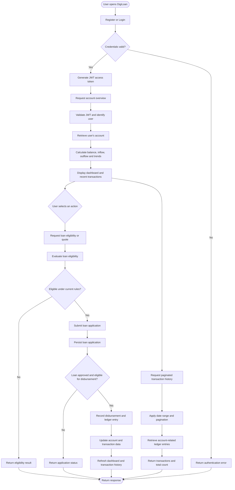
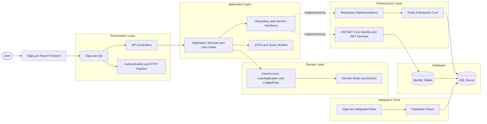

# DigiLoan — Digital Micro-Lending & Escrow Ledger

> **Note**
>
> DigiLoan is a portfolio project demonstrating Clean Architecture, backend development with ASP.NET Core, JWT-based authentication, loan eligibility workflows, and ledger-based transaction tracking.
>
> The project focuses on maintainable application structure, separation of concerns, and practical software engineering patterns for a digital lending system.

DigiLoan is a digital micro-lending application built with **.NET, ASP.NET Core Web API, Entity Framework Core, SQL Server, ASP.NET Core Identity, JWT authentication, and React**.

It provides loan eligibility and application workflows, account overviews, ledger-based transaction tracking, and paginated transaction history through a layered backend architecture.

## Table of Contents

- [Project Overview](#project-overview)
- [Problem Statement](#problem-statement)
- [Core Features](#core-features)
- [Requirement Mapping](#requirement-mapping)
- [Key Workflows](#key-workflows)
- [Business Process Flow](#business-process-flow)
- [Architecture](#architecture)
- [Project Structure](#project-structure)
- [Technology Stack](#technology-stack)
- [API Endpoints](#api-endpoints)
- [Authentication and Authorization](#authentication-and-authorization)
- [Transaction History and Pagination](#transaction-history-and-pagination)

## Project Overview

DigiLoan explores how a digital lending application can organize financial workflows using a layered architecture.

The backend separates domain models, application use cases, infrastructure implementations, and HTTP endpoints. The frontend communicates with the API through an Axios client and uses JWT authentication for protected requests.

The primary goals are to:

- Keep business logic separate from infrastructure and presentation concerns.
- Authenticate users securely using ASP.NET Core Identity and JWT.
- Organize loan eligibility and application workflows.
- Track financial activity through ledger entries.
- Provide account summaries and transaction history.
- Support server-side pagination and date filtering.
- Verify repository behavior through integration tests.

## Problem Statement

Digital lending applications need to manage loan-related workflows while giving users clear visibility into their account activity.

A lending application needs to support:

- **User authentication:** Register users, authenticate credentials, and issue access tokens.
- **Loan eligibility:** Evaluate loan eligibility and provide loan quote information.
- **Loan applications:** Capture application details and maintain application status.
- **Disbursement workflows:** Handle the loan disbursement operation and record related financial activity.
- **Ledger tracking:** Store transaction records associated with accounts.
- **Account overview:** Summarize current balance, inflows, outflows, disbursements, and daily trends.
- **Transaction history:** Retrieve recent or historical account transactions.
- **Pagination:** Retrieve transactions page by page instead of loading the entire history.
- **Testing:** Verify repository queries and pagination behavior against a database.

DigiLoan brings these concerns together in one application, with a focus on separation of responsibilities and understandable backend design.

## Core Features

### Authentication and Security

- User registration and login.
- ASP.NET Core Identity for user management.
- JWT bearer authentication for protected endpoints.
- Token validation for issuer, audience, signing key, and lifetime.
- Password requirements and account lockout configuration.
- Authenticated access to account-specific data.

### Loan Eligibility and Applications

- Loan eligibility evaluation through an application service.
- Loan quote workflow.
- Loan application data transfer objects.
- Loan application status and repayment-related information.
- Loan disbursement workflow.
- Domain-level loan status behavior, including overdue status evaluation when applicable.

### Account Overview

- Retrieve the authenticated user's account.
- Display the account number and current balance.
- Summarize total inflow and outflow.
- Display total disbursed amounts.
- Build daily transaction trends for dashboard charts.
- Show recent transactions ordered by creation time.

### Ledger and Transaction History

- Record account-related ledger entries.
- Associate transactions with source and destination accounts where applicable.
- Track transaction amounts and transaction types.
- Retrieve transactions associated with an account.
- Sort transaction history newest first.
- Support server-side pagination.
- Filter history using a date range.
- Return a paged result containing transaction items, total count, current page, and page size.

### Development and Testing Support

- Development seed-data endpoint for populating sample data.
- Repository integration tests using a database fixture.
- Pagination tests covering multiple pages and total counts.
- Checks for newest-first ordering and overlapping page results.

## Requirement Mapping

| Requirement                 | DigiLoan implementation                                 |
| --------------------------- | ------------------------------------------------------- |
| User authentication         | ASP.NET Core Identity and JWT bearer authentication     |
| Protected API access        | Authorization attributes and JWT validation             |
| Loan eligibility            | Credit-scoring and eligibility application services     |
| Loan quotation              | Loan quote workflow                                     |
| Loan application management | Loan application domain model and DTOs                  |
| Loan disbursement           | Disbursement API workflow and ledger-related operations |
| Financial activity tracking | `LedgerEntry` and `UserAccount` domain models           |
| Dashboard summary           | Account overview application service                    |
| Recent transactions         | Newest-first transaction selection                      |
| Transaction history         | Account-related ledger query                            |
| Pagination                  | `PagedResult<T>` and repository-level pagination        |
| Date filtering              | Optional date range filters in transaction queries      |
| Database persistence        | Entity Framework Core and SQL Server                    |
| Integration testing         | `DigiLoan.IntegrationTests` and database fixture        |

## Key Workflows

### 1. Authentication

1. A user registers or submits login credentials.
2. ASP.NET Core Identity handles user management and credential validation.
3. After successful authentication, the token service generates a JWT.
4. The frontend stores the authentication state and attaches the bearer token to protected API requests.
5. The API validates the token before allowing access to protected endpoints.

### 2. Loan Eligibility and Application

1. The frontend sends a loan eligibility or quote request.
2. The API forwards the request to the relevant application workflow.
3. The eligibility service evaluates the request using the implemented scoring logic.
4. The application receives the eligibility or quote result.
5. When the user submits an application, the application workflow processes the request and maintains the loan application data.
6. The disbursement workflow handles the applicable disbursement operation and related ledger activity.

The exact eligibility criteria and disbursement rules are determined by the implementation; they should not be confused with a real bank's underwriting or settlement process.

### 3. Account Overview

1. The frontend calls `GET /api/account/overview`.
2. The API identifies the authenticated user.
3. The account overview service retrieves the user's account.
4. The service retrieves the account's ledger entries.
5. It calculates overview totals and builds daily trend data.
6. The service maps recent ledger entries into response DTOs.
7. The frontend displays the overview, chart, and recent transactions.

### 4. Paginated Transaction History

1. The frontend requests a page of transactions with the selected date range.
2. The application resolves the user's account.
3. The transaction-history service passes the query parameters to the repository.
4. The repository filters entries by account and date range.
5. The repository sorts the matching entries newest first and retrieves the requested page.
6. The service maps the returned domain entities into DTOs.
7. The API returns the current page, page size, total count, and transaction items.

Server-side pagination prevents the frontend from needing to download the complete transaction history just to display a single page.

### 5. Development Seed Data

1. A developer invokes the development seed-data endpoint.
2. The API runs the configured seeding workflow.
3. Sample data is created for development and testing.
4. The frontend can refresh its overview query to retrieve updated data.

The seed-data endpoint is intended for development and should not be exposed without appropriate safeguards in a production deployment.

## Business Process Flow



> **Implementation note:** This diagram is a high-level business flow. The exact approval checks, state transitions, and database update behavior must match the current code. It does not imply that every application is automatically approved or that every loan application immediately results in a disbursement.

## Architecture

DigiLoan follows a Clean Architecture-inspired structure. The domain contains core business models, the application layer defines use cases and abstractions, the infrastructure layer implements external dependencies, and the API provides HTTP endpoints.



### Architectural Responsibilities

| Layer                       | Responsibility                                                                                       |
| --------------------------- | ---------------------------------------------------------------------------------------------------- |
| `DigiLoan.Domain`           | Core domain entities, enums, and business rules                                                      |
| `DigiLoan.Application`      | Application services, use cases, interfaces, DTOs, and query models                                  |
| `DigiLoan.Infrastructure`   | EF Core persistence, repository implementations, Identity integration, and supporting infrastructure |
| `DigiLoan.Api`              | Controllers, HTTP routing, dependency injection, authentication configuration, and API pipeline      |
| `DigiLoan.IntegrationTests` | Database-backed integration tests for repository and query behavior                                  |

### Dependency Direction

The architecture aims to keep business logic independent of implementation details.

- The domain layer should not depend on Entity Framework Core, controllers, or the database.
- The application layer defines the interfaces required by its use cases.
- Infrastructure implements persistence and external-service interfaces.
- The API connects the application to HTTP requests and configures dependency injection.
- The frontend communicates with the backend through HTTP rather than directly accessing database entities.

This separation makes it easier to understand, test, and change individual parts of the application.

## Project Structure

The following is a conceptual overview of the repository's main responsibilities.

| Project                     | Responsibility                                                                                                                                              |
| --------------------------- | ----------------------------------------------------------------------------------------------------------------------------------------------------------- |
| `DigiLoan.Domain`           | Core domain entities, enums, and business rules for user accounts, loan applications, and ledger entries.                                                   |
| `DigiLoan.Application`      | Application use cases, service interfaces, DTOs, loan eligibility, credit scoring abstractions, account overview logic, and transaction history pagination. |
| `DigiLoan.Infrastructure`   | EF Core persistence, SQL Server integration, repository implementations, ASP.NET Core Identity integration, and JWT token generation.                       |
| `DigiLoan.Api`              | API controllers, authentication and authorization, dependency injection, middleware, Swagger/Scalar documentation, and application startup configuration.   |
| `DigiLoan.IntegrationTests` | Integration tests for database and repository behavior, including ledger entry pagination, total counts, newest-first ordering, and page boundaries.        |

### Important Domain Models

**`UserAccount`**

Represents the application's account associated with a user. The account is used by the account overview and transaction-history workflows.

**`LoanApplication`**

Represents a loan application and its relevant data, including the application number, requested amount, risk score, status, tenor, interest rate, and repayment information.

**`LedgerEntry`**

Represents a recorded financial transaction. Entries include information such as source account, destination account, amount, transaction type, and creation timestamp.

**`ApplicationUser`**

Represents the ASP.NET Core Identity user stored in the Identity tables. Identity user management is kept distinct from the application's `UserAccount` domain model.

## Technology Stack

| Technology                | Purpose                                          |
| ------------------------- | ------------------------------------------------ |
| C#                        | Backend programming language                     |
| .NET 10                   | Backend runtime and SDK target                   |
| ASP.NET Core Web API      | HTTP API and request handling                    |
| ASP.NET Core Identity     | User management and authentication               |
| JWT Bearer Authentication | Token-based API authentication                   |
| Entity Framework Core     | Object-relational mapping and database access    |
| SQL Server                | Relational database                              |
| React                     | Frontend user interface                          |
| Axios                     | HTTP requests and authentication headers         |
| Zustand                   | Frontend authentication state                    |
| TanStack React Query      | Server-state fetching, caching, and invalidation |
| Recharts                  | Dashboard charts and transaction trends          |
| Swagger / Scalar          | API exploration and documentation                |
| xUnit                     | Automated testing                                |

## API Endpoints

The following endpoints reflect the routes discussed in the project. Check the current controller attributes and request DTOs for the exact request schemas and all available operations.

### Account Overview

| Method | Endpoint                | Purpose                                            |
| ------ | ----------------------- | -------------------------------------------------- |
| `GET`  | `/api/account/overview` | Retrieve the authenticated user's account overview |

The overview response includes account information, summary totals, daily trend data, and recent transactions.

### Loan Disbursement and Quotes

| Method | Endpoint                     | Purpose                                                   |
| ------ | ---------------------------- | --------------------------------------------------------- |
| `POST` | `/api/disburse/quote`        | Request a loan quote                                      |
| `GET`  | `/api/disburse/applications` | Retrieve loan applications available through the endpoint |
| `POST` | `/api/disburse/disburse`     | Execute the implemented disbursement workflow             |

These endpoints are protected according to the controller's authorization configuration. The request body and the exact business rules should be taken from the corresponding controller and DTO definitions.

### Development Seed Data

| Method | Endpoint             | Purpose                   |
| ------ | -------------------- | ------------------------- |
| `POST` | `/api/dev/seed-data` | Populate development data |

This endpoint is for development support, not a general-purpose production operation.

### Authentication

Registration and login are exposed through the authentication endpoints used by the frontend. Check the current authentication controller for their exact routes and request formats.

## Authentication and Authorization

DigiLoan uses ASP.NET Core Identity for user management and JWT bearer authentication for API access.

### Authentication Flow

1. A user submits registration or login credentials.
2. The authentication workflow validates the credentials through the configured Identity system.
3. The token service generates a JWT for an authenticated user.
4. The frontend attaches the token to protected API requests:

   ```http
   Authorization: Bearer <access-token>
   ```

5. ASP.NET Core validates the token and builds the authenticated principal.
6. Endpoints protected by `[Authorize]` require a valid authenticated identity.

### JWT Validation

The token validation configuration checks:

- Token issuer.
- Token audience.
- Signing key.
- Token lifetime.

The token service uses the authenticated user's identifier and email when generating a token. Protected application workflows use the authenticated identity to determine which user's account data can be accessed.

### Frontend Authentication

The frontend's Axios client uses an interceptor to attach the stored access token to requests. Authentication state is managed through Zustand, while TanStack React Query handles server-state fetching and cache invalidation.

A `401 Unauthorized` response indicates that authentication is missing or invalid; the frontend's response handling can react to that condition.

## Transaction History and Pagination

Transaction history is retrieved through a server-side paginated query.

### Why Server-Side Pagination?

Loading every transaction into the browser and then slicing the array works for small datasets, but it becomes inefficient as the transaction history grows.

DigiLoan instead requests only the selected page from the backend. This allows the database to filter, sort, and limit the results before they are returned to the frontend.

### Pagination Model

The application uses a generic `PagedResult<T>` model with the following information:

| Property     | Purpose                                            |
| ------------ | -------------------------------------------------- |
| `Items`      | The records returned for the current page          |
| `TotalCount` | Total number of matching records before pagination |
| `Page`       | Current page number                                |
| `PageSize`   | Maximum number of records requested per page       |

The transaction-history service returns a paged DTO result rather than exposing persistence entities directly to the API.

### Repository Query

The repository's pagination method accepts an account ID, optional UTC date boundaries, page number, and page size.

Conceptually, the query:

1. Filters ledger entries associated with the account as either the source or destination.
2. Applies the optional date-range filter.
3. Counts the matching records.
4. Sorts entries by creation time, newest first.
5. Skips the records from preceding pages.
6. Takes the requested page of records.

The repository returns the selected entities together with the total count. The application service then maps those entities into response DTOs.

### Example

Suppose 25 transactions match the selected filters and the page size is 10.

| Page   | Returned records | Expected count |
| ------ | ---------------- | -------------: |
| Page 1 | Records 1–10     |             10 |
| Page 2 | Records 11–20    |             10 |
| Page 3 | Records 21–25    |              5 |

The total count remains `25` on each page, even though the number of returned items varies on the last page.

The frontend can use this information to display pagination controls such as `1–10 of 25`.

## Testing Strategy

DigiLoan includes database-backed integration tests for repository behavior.

### Ledger Entry Repository Pagination Test

The integration test creates an account and seeds 25 ledger entries with different creation timestamps. It then requests pages using a page size of 10.

The test verifies that:

- The total number of matching entries is 25.
- Page 1 returns 10 entries.
- Page 2 returns 10 entries.
- Page 3 returns the remaining 5 entries.
- Results are ordered newest first.
- Pages do not contain overlapping transaction IDs.

The test uses a database fixture so that repository behavior is exercised against a database rather than being replaced with a mock of the same repository interface.

This distinction matters: a repository integration test should test the actual repository query and persistence behavior. A mocked repository is more appropriate for an isolated application-service unit test.
